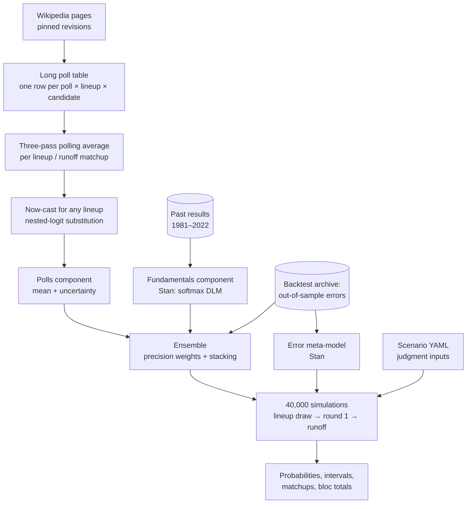

# Model overview

This page follows the model from raw polls to probabilities, stage by stage. For each stage it says what it does, why, where the code is, and which numbers come from the FiftyPlusOne post and which were our own choices. `config/model.yaml` tags every parameter with its source: `post`, `law`, `assumption` or `estimated`.

The statistics behind the stages (shrinkage, hierarchical models, random walks, MCMC, Student-t errors) are explained in the [tutorial](bayesian-tutorial.md).

## The idea in one paragraph

A poll is a noisy, biased measurement of an election that hasn't happened yet. The model does three things:

1. **Clean the measurements.** It combines polls into an average, correcting for pollster lean and for age.
2. **Add a second, independent opinion.** A "fundamentals" model predicts the result from history alone and knows nothing about current polls. Each opinion's weight depends on how accurate it has been out of sample.
3. **Describe how wrong the combined estimate might be, then simulate.** A model of its own past errors sets the size of the error. The election is then simulated 40,000 times, including the runoff. Probabilities are the fractions of simulations: "Le Pen wins 49%" means she won in 49% of them.

## Pipeline

The two elections share the averaging, ensemble and error machinery. They differ in what a "race" is:

- **Presidential:** a race is one national contest, per *lineup* in the first round and per *matchup* in the runoff.
- **Legislative:** a race is one of 577 constituencies, and the national polls play the part of the post's "generic ballot".

---

## Stage 1 — Ingest: from web tables to a long table

**Code:** `forecast/ingest/`.

Poll data comes from English Wikipedia pages, pinned to one revision each so every run is reproducible. The pinned HTML is cached in `wiki_cache/`, so the pipeline runs offline.

**Choosing tables.** The rules in `data/reference/pages.yaml` decide which tables on a page to read. For example, the 2027 page's "Re-run of the 2022 election" tables are excluded, and the tables testing Bardella as RN candidate are included even though they sit under an odd heading.

**One row per poll row × candidate.** Each output row carries:

- the pollster, both as written and as a canonical firm name (so "Ifop-Fiducial" becomes Ifop);
- the fieldwork dates, sample size and survey mode;
- the *lineup*, meaning the set of candidates that row tested.

French pollsters test several hypothetical fields in one survey (with Philippe; with Attal instead; with both). Each of those rows is kept as a separate lineup.

**Rows removed:**

- previous results ("2022 election");
- timeline notes such as "Zemmour announces his candidacy", which go to an events table;
- polls in the field on or after election day;
- implausible rows.

**Special cells:**

- A "<1%" cell is stored as 0.5 and flagged.
- When one alliance figure spans several party columns in a legislative table (a merged cell), it is counted once.

**Results data** (for fundamentals and the legislative model) comes from two official sources:

- data.gouv.fr's harmonised polling-station results, for 1999–2026;
- the Ministry's per-constituency files for 2024, which the harmonised data lacks.

## Stage 2 — The polling average (three passes)

**Code:** `forecast/polls/weights.py`, `trend.py`, `house_effects.py` and `ewma.py`.

This follows the post's § 3.1.1. Everything is done on the **log-share scale**: we work with log(share) and renormalise so the shares sum to 100%. That is the natural scale for a many-candidate race, for three reasons:

- a pollster "adding 2 points to RN" is closer to a proportional than an additive effect;
- errors of small and large candidates become comparable;
- renormalising (a softmax) always gives a valid set of shares.

### Weights

Each poll gets a weight that is the product of four parts:

| Part | Formula | Source |
|---|---|---|
| Recency | $(1-\delta_h)^{\text{age}}$, with $\delta_h$ = 3%/day early, 14%/day in the last 14 days, and a linear ramp from 45 days out | post (endpoints), assumption (ramp) |
| Rolling-tracker overlap | the share of this release's fieldwork days that no other release from the same tracker also covers | French addition |
| Sample size | $\sqrt{\min(n, 4000)/1000}$ | assumption |
| Partisan sponsor | ×½, plus a 2-point shift away from the sponsor | post |

Only polls from the last 90 days count.

### Trend

The trend is the counterpart of the post's generic-ballot adjustment. A poll from three weeks ago is moved by how much its candidate has moved since, measured across *all* lineups: $\log y_{\text{adj}} = \log y + \theta_c(\text{today}) - \theta_c(\text{poll date})$.

- $\theta_c$ is a local-linear kernel smooth of candidate $c$'s log shares.
- Lineup composition (a candidate polls lower in a crowded field) is absorbed by a lineup effect $\lambda$.
- The trend is never extrapolated past a candidate's last poll; it is held flat. Without this, a candidate unpolled since July would follow July's slope into September.

### The three passes

1. **Pass 1:** a recency-weighted average of the trend-adjusted polls, per lineup and day.
2. **Pass 2: house and mode effects.** Each poll's residual is its difference from the pass-1 average of the *other* polls. From these residuals:
   - Each firm's average residual per candidate is its lean. It is **shrunk** by $n/(n+5)$, so five polls earn half credit.
   - It is blended with the firm's lean in past cycles (older cycles count half as much), with the historical part capped at 10%.
   - A lineup-specific extra is added back at $n/(n+20)$.
   - Effects are centred so the average firm has zero lean.

   Subtracting the effects and re-averaging gives the pass-2 average. Mode effects (phone vs online) are estimated the same way, by mode instead of firm.
3. **Pass 3:** the same adjustment for the surveyed population (all adults, registered voters, likely voters). It is effectively a no-op in France, where polls report voters certain to vote.

"Shrink by $n/(n+k)$" is the most important Bayesian idea in the whole model; the [tutorial](bayesian-tutorial.md#2-shrinkage) derives it.

**Check:** two days before each election from 2002 to 2022, the pass-2 average's mean absolute error against the result is 1.0 point.

## Stage 3 — Now-cast for lineups nobody polled

**Code:** `forecast/polls/lineups.py`.

This follows the post's § 3.1.2 (its now-cast for unpolled seats). A scenario can contain a lineup no pollster has tested exactly, for example Le Pen + Philippe + Attal + Glucksmann + Villepin. The model predicts it with a **nested logit**:

$$P(j) = P(\text{bloc } b)\cdot P(j\mid b),\qquad P(j\mid b)=\frac{e^{u_j/\mu_b}}{\sum_{k\in b}e^{u_k/\mu_b}}$$

- $u_j$ is a candidate's strength.
- $\mu_b\in(0,1]$ says how loyal a bloc's voters are: when one centrist drops out, what share goes to the other centrist rather than elsewhere?
- $u$ and $\mu$ are fitted to every race's current average; races tested side by side in one poll pin $\mu$ down.

Lineups that *were* polled are then anchored to their own average. The final estimate is the poll average plus the now-cast's disagreement with it, clipped to ±2 points with one poll, shrinking to ±⅓ point by five polls (post).

The model's error on lineups it didn't see is estimated by leaving each race out in turn, and is added to the uncertainty of unpolled lineups.

## Stage 4 — How far the average can still move

**Code:** `forecast/polls/horizon.py`.

This follows the post's § 3.1.3. Today's average isn't the election result. From the 2002–2022 backtest, the sd of (log result − log average) grows with the days $h$ still to go and shrinks with candidate size:

$$\sigma(h,s)=(a+b\sqrt h)\,(s/10\%)^{-\gamma}$$

The fitted values are about $a = 0.14$, $b = 0.031$ and $\gamma = 0.26$. For a 15% candidate that gives roughly ±2.3 points two days out and ±6 points 200 days out. This is the polls component's stated uncertainty.

We also tested a *vote utile* drift term, where leading candidates gain late. It made out-of-sample error worse (2.1 → 2.7 points), so it is off.

## Stage 5 — Fundamentals (a second opinion from history)

**Code:** `forecast/fundamentals/` and `forecast/stan/fundamentals_dlm.stan`.

This follows the post's § 3.2. The component predicts first-round shares **without any polls**, from four predictors:

| Predictor | Meaning |
|---|---|
| `log_baseline` | log of the candidate's bloc share in the last two presidential first rounds (80/20 weights), split among same-bloc candidates |
| `incumbency` | 1 for a sitting president; ½ for a sitting PM or the governing party's nominee |
| `experience` | office grade 0–3, scaled to 0–1 |
| `personal_vote` | how much the candidate beat or missed their baseline in earlier runs |

It is a multinomial-logit regression. Its coefficients are allowed to **drift** from one election to the next as a random walk, the "dynamic linear model" the post uses. It is fitted in Stan on the elections from 1995 to 2022; the [tutorial](bayesian-tutorial.md#6-the-fundamentals-model-in-stan-line-by-line) walks through it line by line.

For French presidential elections it is weak, with about 5.5 points of error. That is exactly why the next stage weights components by measured accuracy.

## Stage 6 — Ensemble

**Code:** `forecast/ensemble/stacking.py`.

This follows the post's § 4. Each component's out-of-sample error scale is fitted on the backtest archive with the same $(a+b\sqrt h)(s/10)^{-\gamma}$ form, and the weights are inverse variances, $w_k\propto 1/\sigma_k^2$. A **stacking** multiplier is then chosen by trying values on earlier cycles and keeping the one that minimised out-of-sample error; for the fundamentals it came out at 0.25–0.5.

Two adjustments come from the post:

- down-weight fundamentals when no incumbent runs;
- up-weight polls when a heavily polled race disagrees sharply with the fundamentals.

The result is a mean per candidate, plus $\bar\sigma=\sum_k w_k\sigma_k$ and a "disagreement" score. For 2027 the polls get about 87–96% of the weight.

## Stage 7 — Error meta-model

**Code:** `forecast/errors/meta_model.py` and `forecast/stan/error_meta.stan`.

This follows the post's § 4.1.1. Every backtest snapshot records its errors, err = log(result) − ensemble mean. A Bayesian model then splits those errors into two parts:

- **shared shocks**, which move a whole group together. For the presidential model the group is a bloc. For the legislative model there are four levels: national bloc, region, département and vote-pattern cluster.
- **an individual error**, whose size is the ensemble's stated $\bar\sigma$ times a fitted multiplier. The multiplier grows where polls are scarce or the components disagree.

Each level's sd follows $a+b\sqrt{\text{days}}$. The likelihood is a Student-t with degrees of freedom ν equal to the number of training cycles. This is the post's way of admitting that thousands of rows still come from only a handful of elections, so large surprises must stay plausible.

## Stage 8 — Simulation

**Code:** `forecast/simulate/`.

The presidential simulation repeats these steps 40,000 times.

1. **Lineup.** Draw one from `scenarios_pres_2027.yaml`: the RN candidate (Le Pen 95%), the Socialist primary winner, and whether optional candidates run.
2. **Mid-campaign decisions.** Draw the error that will have played out by 15 January 2027: about 43% of the total variance. Compute the January polls, then apply the centrist rule:
   - if the leading centrist polls above 15%, they run alone;
   - otherwise the top two, plus anyone above 10%, run.
3. **First-round shares.** Take the ensemble mean, add the rest of the error (shared bloc shocks plus individual shocks, all Student-t), then apply a softmax. Shocks are drawn in ± pairs (antithetic), so they average to exactly zero and never move the central estimate (post).
4. **Round-one outcome.** A candidate above 50% wins outright. Otherwise the top two go through.
5. **Runoff.**
   - Start from the matchup's polling average, if one exists.
   - Otherwise use a **transfer model**: each first-round electorate splits between the two finalists and abstention according to left–right distance and candidate appeal.
   - Move the runoff mean with the simulated first round, so a first-round surprise carries into round two.
   - Add a runoff error correlated with the finalists' first-round shocks.

The outputs are the shares of simulations in which each thing happened:

- P(runs), P(reaches runoff) and P(wins), per candidate and pooled by bloc;
- vote-share quantiles;
- matchup probabilities;
- how often each outcome of the January decision occurred.

The legislative simulation runs in chunks of 200 simulations at a time, to save memory. Each simulation goes through these steps.

1. **Alliance scenario.** Draw one from `scenarios_legi.yaml`: left united or split.
2. **First-round shares in all 577 seats.** Add the five error levels to each seat's ensemble mean.
3. **Turnout.** Draw each seat's turnout.
4. **Round-one outcome.** Apply the legal rules. A candidate wins outright with more than 50% of votes cast *and* at least 25% of registered voters. Anyone with at least 12.5% of registered voters goes through to round two; if fewer than two do, the top two go through.
5. **Withdrawals.** Third-placed candidates withdraw with probabilities estimated from 2012–2024, moved together by a shared "front républicain" shock.
6. **Second round.** Compute shares with a bloc-to-bloc transfer matrix, perturbed once per simulation.
7. **Count seats.**

The outputs are seat distributions, P(≥ 289 seats) and P(largest bloc).

## Stage 9 — Backtesting ("no time travel")

**Code:** `forecast/backtest/` and `forecast/legislative/pipeline.py`.

The backtest replays history in time order. For each past cycle it takes weekly snapshots from 156 days out. Each snapshot uses only:

- polls published by that date;
- models trained on *earlier* cycles.

The backtest also produces the archive that the ensemble weights and the error meta-model are trained on. So every error the meta-model learns from is a genuine out-of-sample error.

Presidential results, 2002–2022 (115 snapshots):

| Metric | Value |
|---|---|
| Vote-share error, last two weeks | 1.1 points |
| Vote-share error, 3–5 months out | 2.6 points |
| 50% / 90% interval coverage | 44% / 85% |
| Brier score, P(win) | 0.034 |
| Brier score, P(reach runoff) | 0.049 |

The legislative model has only three test cycles, and its uncertainty ranges are still very wide.

## What is judgment rather than data

The model separates estimated quantities from judgment calls, as the post does. The judgment calls live in files you are meant to edit, date and disclose:

- `data/reference/scenarios_pres_2027.yaml`: the lineup probabilities and the January centrist rule;
- `data/reference/scenarios_legi.yaml`: the legislative date, left alliance odds, incumbents' re-run rate and turnout spread;
- `data/reference/priors.yaml`: the weakly informative defaults used when no history exists yet.

## Known limitations

- **Few elections.** Five presidential cycles with polls, and three or four legislative ones. Tails are fat by design, and early backtest cycles rely on the priors.
- **Backtests use the actual ballot.** Candidate declaration dates are not curated, so historical lineup uncertainty isn't tested.
- **Legislative weak points.** Stale national polls, seat ranges too wide to be decision-useful, and transfer patterns that change from one election to the next (2017 and 2022 both missed RN).
- **Transfer models are simpler than planned.** Both are scipy fits rather than the planned Stan transfer model.
